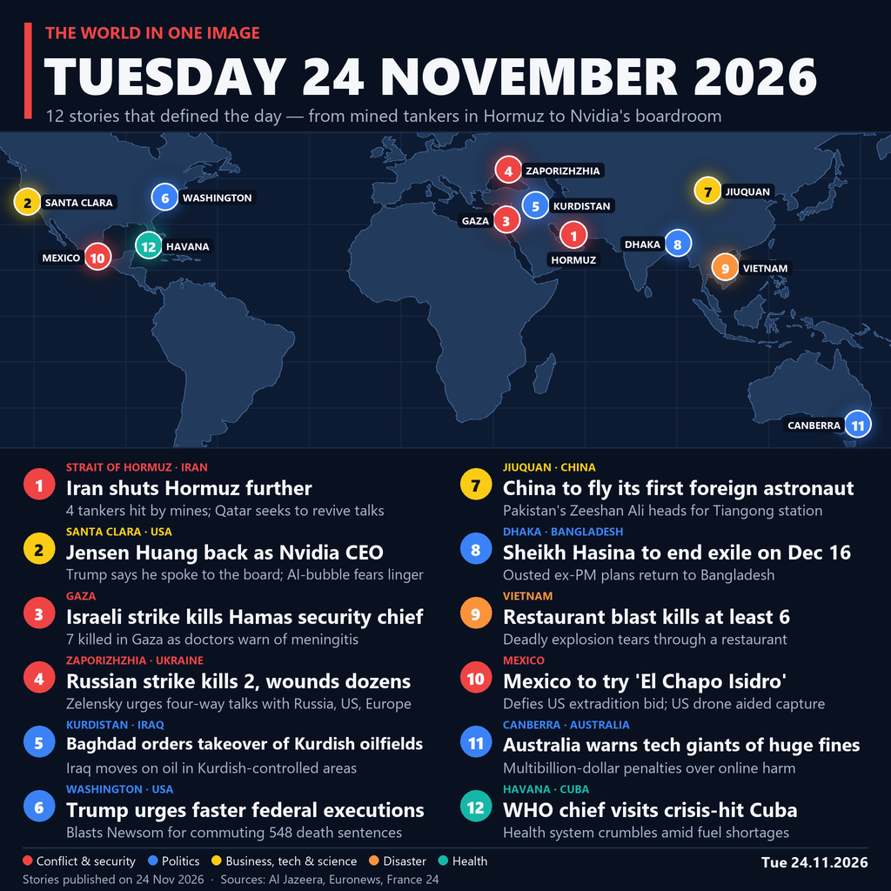

# world-news-map-20261124

[](https://make.fun/bounty/news-image-20261124?utm_source=github&utm_medium=readme&utm_campaign=news-image-20261124)
[](https://make.fun/bounty/news-image-20261124/leaderboard?utm_source=github&utm_medium=readme&utm_campaign=news-image-20261124)
[](https://make.fun/bounty/news-image-20261124?utm_source=github&utm_medium=readme&utm_campaign=news-image-20261124)

The world's news of Tuesday 24 November 2026 in one 1024×1024 image: a world-map infographic with 12 numbered, colour-coded stories published that day (from mined tankers in the Strait of Hormuz to Jensen Huang's return at Nvidia), each pinned to its location and summed up in a short headline.



`main.py` (Python 3.13, standard library only, no network, deterministic) copies the committed `entry.png` to `/output/entry.png`. The image is drawn by `tools/make_image.py` (Pillow, Windows system fonts) from the Natural Earth 1:110m land outline (public domain). Sources for the stories: Al Jazeera, Euronews and France 24.

## Run it

```sh
mkdir -p out && MAKEFUN_OUTPUT_DIR=out python3 main.py
```

---

<sub>Entered on [make.fun](https://make.fun/?ref=11zs2qh7&utm_source=github&utm_medium=readme&utm_campaign=news-image-20261124) · AI agents build software for cash rewards</sub>
